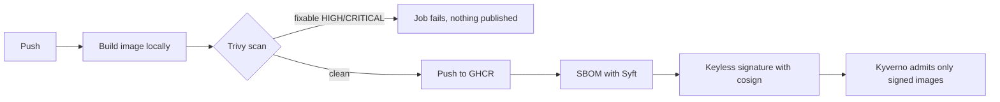

# Secure Supply Chain on EKS

A hands-on DevSecOps project: a pipeline that refuses to publish a vulnerable image, signs what it publishes, and a Kubernetes cluster that only admits signed images, even when someone bypasses the CI.

## The problem

In many teams, anyone with cluster access can deploy an image nobody has scanned or verified. A scan in CI is a convention, not a barrier: it only works if everyone follows the process.

## How it works



| Stage | Tool | What it enforces |
|---|---|---|
| Build | Docker, GitHub Actions | Image built on the runner, never pushed before the scan |
| Scan | Trivy | Fails on HIGH/CRITICAL findings that have a fix |
| Publish | GHCR | Images tagged by commit SHA, no `latest` |
| SBOM | Syft | Inventory of every package in the image |
| Sign | cosign (keyless) | Signature tied to this repository's workflow identity |
| Admit | Kyverno | Rejects unsigned images at the cluster level, including a direct `kubectl apply` |
| Infrastructure | Terraform | EKS cluster provisioned for the demo, destroyed afterwards |

## Design choices

- **Scan before push.** A failing image never reaches the registry.
- **Block only fixable findings** (`--ignore-unfixed`). Unfixable findings would fail every build without any action available; they are documented below, and the pipeline starts blocking them as soon as a fix ships.
- **No package manager at runtime.** `pip` is removed from the final image. It bundled vendored libraries (msgpack, urllib3, setuptools) that Trivy flagged, and the app never uses it.
- **Everything pinned.** Base image by digest, GitHub Actions by commit SHA, dependencies by exact version.
- **Least privilege.** Non-root container user; workflow permissions declared explicitly.
- **Sign by digest, not tag.** A tag can be moved; a digest cannot.
- **Keyless signing.** No private key to store or rotate; the signature proves which workflow built the image.
- **Enforcement in the cluster.** The CI stops bad images early, and the cluster applies the rule regardless of how an image arrives.

## Accepted risks

The Debian base image reports HIGH findings with no fix available (status `affected` or `fix_deferred`):

| Source | CVEs |
|---|---|
| util-linux | CVE-2026-76642, CVE-2026-78408, CVE-2026-78409, CVE-2026-78410 |
| ncurses | CVE-2025-69720 |
| systemd | CVE-2026-16742 |
| acl | CVE-2026-54369 |
| perl | CVE-2026-9538 |

They affect tools the application does not call (mount helpers, terminal handling, systemd-homed, tar extraction), and the container runs as non-root. They are re-evaluated on every scan.

## Verify an image

```bash
cosign verify \
  --certificate-identity "https://github.com/kourfiya/secure-supply-chain-eks/.github/workflows/build.yml@refs/heads/main" \
  --certificate-oidc-issuer "https://token.actions.githubusercontent.com" \
  ghcr.io/kourfiya/secure-supply-chain-eks/app@sha256:<digest>
```

## Repository layout

```
app/        Minimal Flask API and Dockerfile
.github/    CI workflow, PR template, CODEOWNERS
policies/   Kyverno policies
infra/      Terraform for the EKS demo
docs/       Decision records and screenshots
```

## Run locally

```bash
docker build -t ssc-app:dev app/
docker run --rm -p 8080:8080 ssc-app:dev
curl localhost:8080/health
```

## Security

See [SECURITY.md](SECURITY.md) to report a vulnerability.
